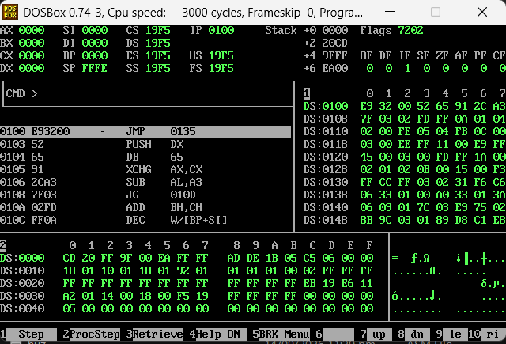
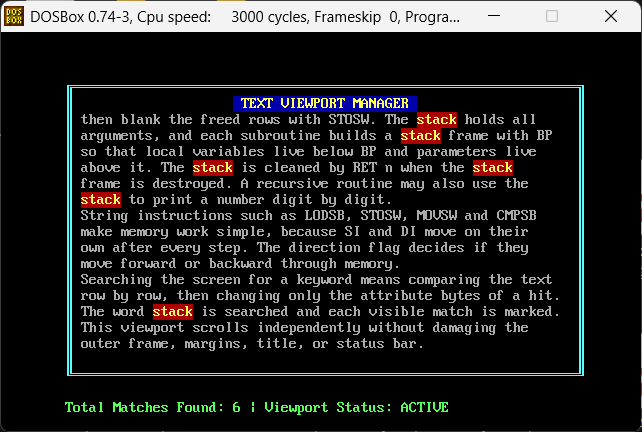

# COAL Assembly Programs

A collection of 8086 assembly language programs written for the Computer Organization and Assembly Language (COAL) course. Each assignment lives in its own folder, and output screenshots are kept in a separate folder.

## Student Details

| | |
|---|---|
| **Name** | Muhammad Ahsan |
| **Roll No** | 25L-0542 |
| **Course** | Computer Organization and Assembly Language (COAL) |
| **University** | FAST-NUCES Lahore |

## Description

This repository contains my COAL assignment programs, written in 16 bit real mode x86 assembly. The programs work directly with BIOS and DOS services, video memory, the stack, and string instructions.

One of the programs, the Text Viewport Manager in Assignment 3, draws a framed text window with a title bar and a status bar. It scrolls text inside the viewport without damaging the outer frame, and it searches the displayed text for a keyword, highlights every match, and shows the total number of matches found.

## Tools Used

- **NASM** for assembling the source files
- **DOSBox** for running the programs in a DOS environment
- **Notepad** for writing the code
- **Git and GitHub** for version control

## How to Assemble and Run

1. Mount the project folder in DOSBox:
```
   mount c C:\path\to\COAL-Assembly-Programs
   c:
```
2. Assemble a program (replace the folder and file name with your own):
```
   nasm -f bin Assignment3\q2.asm -o q2.com
```
3. Run the generated file:
```
   q2.com
```

## Folder Structure

```
COAL-Assembly-Programs/
├── README.md
├── Assignment2/
├── Assignment3/
└── screenshots/
```

## Output Screenshots

### Assignment 2

**Question 4**



### Assignment 3

**Question 2: Text Viewport Manager**


